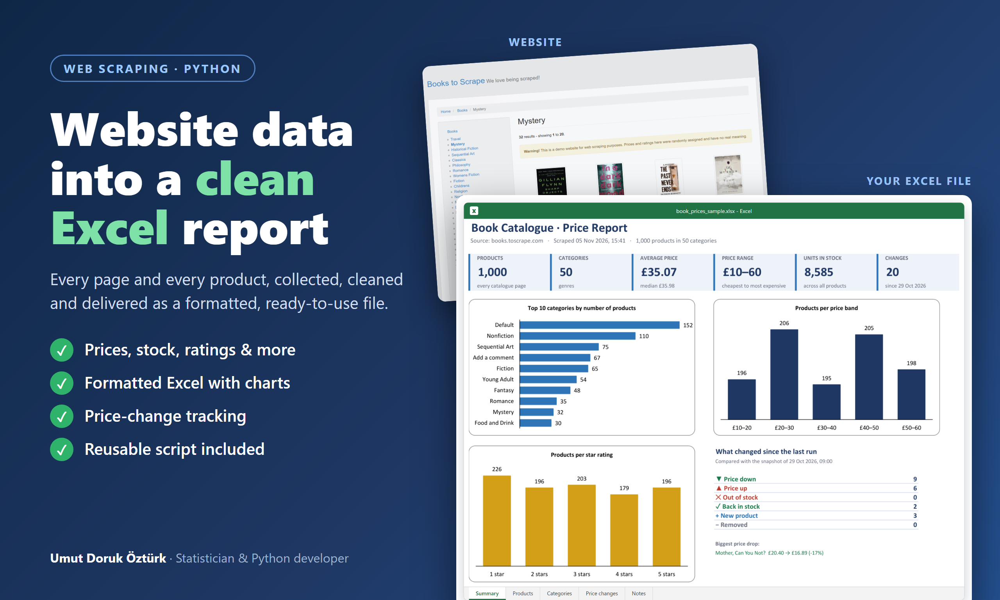
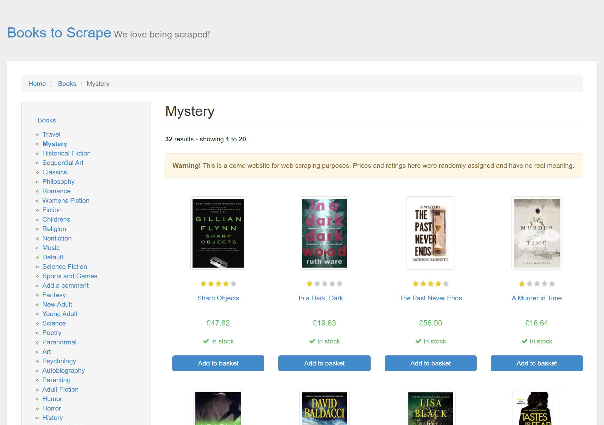
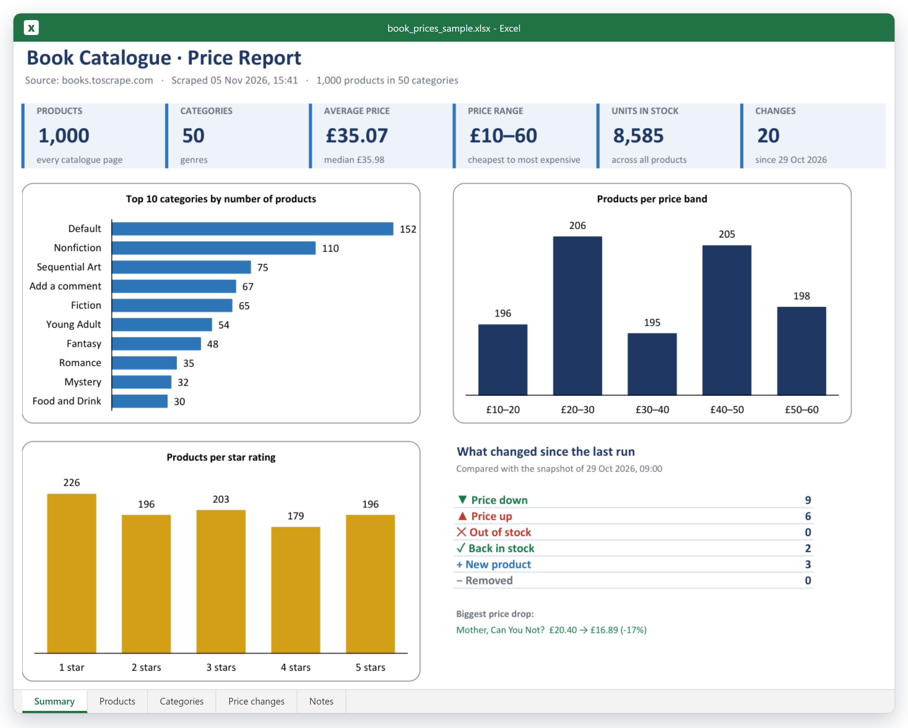
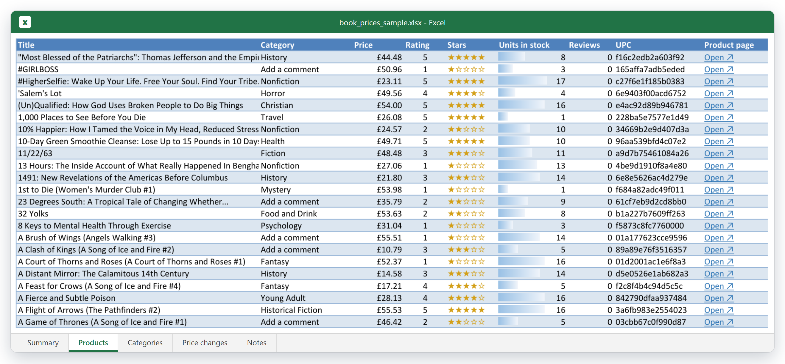
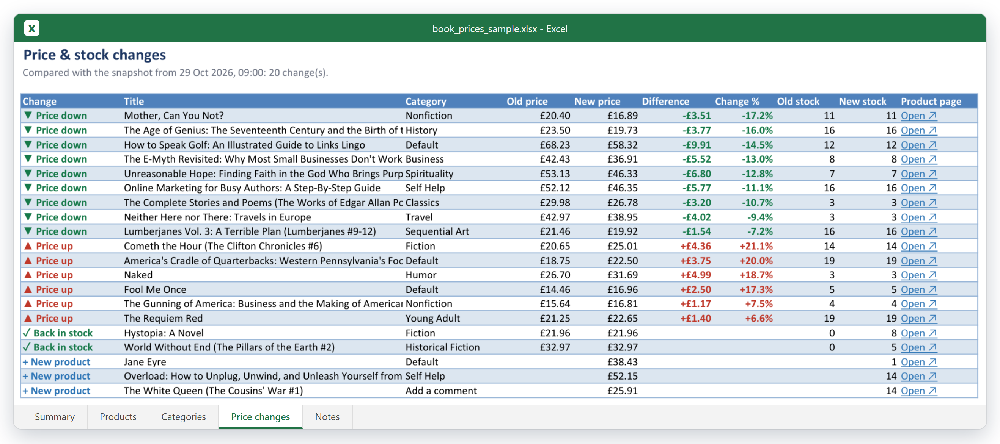
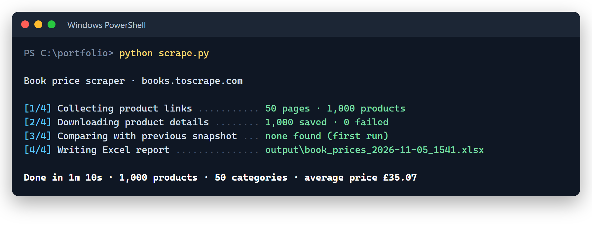

# Website → Excel: Product Price Scraper

**Collects every product from an online shop and delivers a clean, formatted Excel report, with price-change tracking between runs.**



> Built as a portfolio demo on [books.toscrape.com](https://books.toscrape.com), a website made for scraping practice.
> The same approach works for online shops, directories, property and car listings, job boards and other **public** data.

---

## The problem

> *"I want my competitor's full catalogue (prices, stock and ratings) in Excel, and every week I want to know what changed."*

Doing that by hand means opening 1,000 product pages and copying them one by one, and doing it again next week.

## The result

| | |
|---|---|
| **Pages visited** | 50 listing pages + 1,000 product pages |
| **Run time** | 1 min 10 s |
| **Failed requests** | 0 (automatic retries) |
| **Output** | Formatted Excel file: 5 sheets, charts, filters, clickable links |
| **Refresh** | Double-click `run.bat` |

📥 **[Download the sample Excel file](sample_output/book_prices_sample.xlsx)**

### Before: the website



### After: one Excel file

**Summary**: the key numbers and charts at a glance.



**Products**: one row per product, filters on every column, a link to every product page.



**Price changes**: what got cheaper, more expensive, sold out or is new since the last run.



---

## What you get

- **Every product**: title, category, price, star rating, units in stock, reviews, UPC, link and description
- **Clean data**: prices stored as numbers (not text), duplicates removed, consistent formats
- **A ready-to-read report**: summary dashboard, charts, filters and frozen headers
- **Change tracking**: every run is saved and compared with the previous one (prices, stock, new and removed products)
- **One-click refresh**: double-click `run.bat`, no coding needed
- **The script itself**, so you can refresh the data whenever you like

## How it works

```
50 listing pages ─► 1,000 product links ─► product pages (6 in parallel, polite delay, auto-retry)
   ─► clean & de-duplicate ─► save snapshot (CSV) ─► compare with last snapshot ─► Excel report
```



## Run it yourself

```bash
pip install -r requirements.txt
python scrape.py
```

| Option | What it does |
|---|---|
| `--max-pages 2` | Quick test on the first 2 listing pages |
| `--workers 6` | Number of parallel downloads |
| `--delay 0.15` | Pause before each request (seconds) |
| `--compare FILE.csv` | Compare with a specific snapshot instead of the latest one |
| `--from-snapshot FILE.csv` | Rebuild the Excel report from a saved snapshot, without scraping |

Run the tests with `python -m pytest`.

## Project structure

```
price-scraper-excel/
├── scrape.py                  # command-line entry point
├── run.bat                    # double-click launcher for Windows
├── price_scraper/
│   ├── fetch.py               # polite HTTP session: retries, back-off, delays
│   ├── parse.py               # HTML → clean records
│   ├── compare.py             # snapshot comparison (price, stock, new, removed)
│   └── excel_report.py        # formatted workbook with charts
├── tests/                     # parser and comparison tests (pytest)
├── snapshots/                 # one CSV per run (used for change tracking)
└── sample_output/             # the sample Excel file shown above
```

**Tech:** Python · requests · BeautifulSoup · pandas · openpyxl · pytest

## Responsible scraping

- Public data only: no logins, no personal data
- Requests are spaced out and limited in number, with retries and back-off, so the site is never overloaded
- Before every client project I check the website's terms of use and `robots.txt`

## About the sample data

- Every product in the sample was really scraped from the demo site.
- The demo site's prices never change, so for the sample the previous snapshot
  (`snapshots/books_2026-10-29_0900_SIMULATED.csv`) was made from the real data with a few prices and products
  edited by hand. That's how the *Price changes* sheet has something to show.
- "Default" and "Add a comment" are category names used by the demo site itself.

---

## Need something like this?

I build web scrapers and data automation for businesses: **price monitoring, product catalogues, lead lists, listings, job posts**. You get clean Excel or Google Sheets files, plus the script if you want it.

**Umut Doruk Öztürk** · Statistician (METU) & Python developer
[Upwork](https://www.upwork.com/freelancers/YOUR-PROFILE) · [Fiverr](https://www.fiverr.com/YOUR-USERNAME) · [LinkedIn](https://www.linkedin.com/in/umut-doruk-ozturk)
